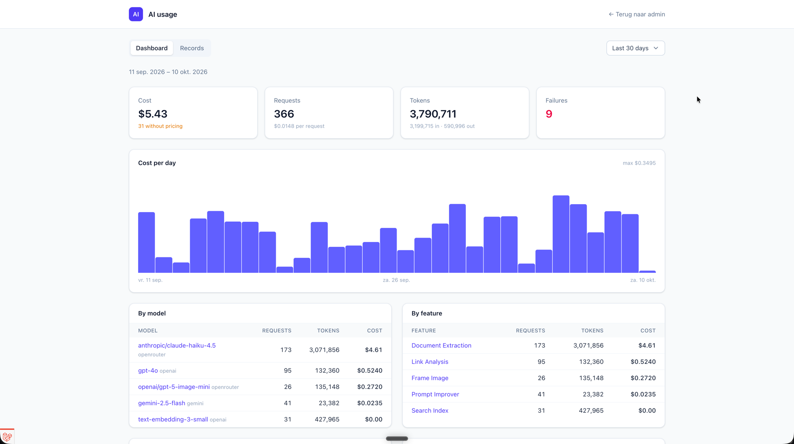
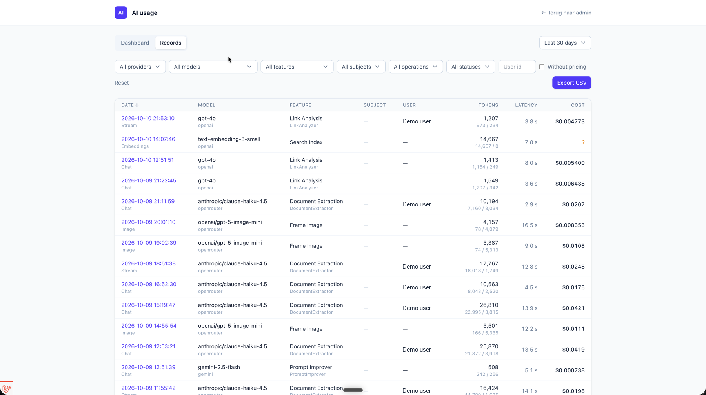
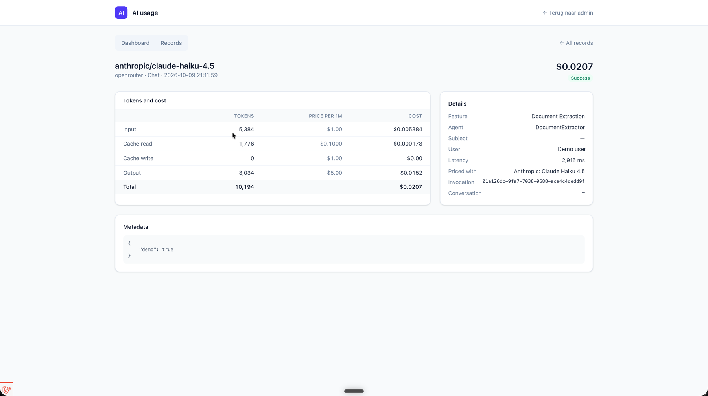

# Laravel AI Usage

[](https://github.com/spaanproductions/laravel-ai-usage/actions/workflows/run-tests.yml)

Tracks the tokens and cost of **every** [laravel/ai](https://github.com/laravel/ai) call in your
application and shows them on a filterable dashboard. Usage is recorded automatically from the
laravel/ai events, priced with a model price list synced from OpenRouter, and attributed to a
feature, a subject (any Eloquent model) and a user. The pages are standalone Livewire pages that ship
their own compiled CSS, so they work without your application's Tailwind build.

- Records agent prompts and streams, embeddings, images, transcriptions, reranking and failovers.
- Prices every call when it is recorded (input, cached input, cache write and output tokens) and keeps the rates used.
- A dashboard with a chart of cost, tokens or requests (per hour, day or month) and breakdowns, a record list with filters, sorting and CSV export, a detail page per call, and a model list with a sync button.
- Budgets per day, week or month, with an event and an optional mail.
- Prompt and response text are **not** stored unless you enable it.



<table>
	<tr>
		<td></td>
		<td></td>
	</tr>
</table>

## Requirements

- PHP 8.4+
- Laravel 12 or 13, Livewire 4
- `laravel/ai` 0.9 or newer, including 1.x

## Installation

```bash
composer require spaanproductions/laravel-ai-usage
```

Publish the migrations and run them (after an update, publish `ai-usage-migrations` again for new migrations). The `ai_models` table (the price list) has its own tag, so skip it if your application already has that table:

```bash
php artisan vendor:publish --tag=ai-usage-migrations
php artisan vendor:publish --tag=ai-usage-models-migrations
php artisan migrate
```

If one of the table names (`ai_models`, `ai_usage_records`, `ai_usage_budget_alerts`) is already taken in your application, publish the config (`php artisan vendor:publish --tag=ai-usage-config`) and change `tables` before running the migrations. The migrations and the models both read these names:

```php
'tables' => [
    'models' => 'ai_models',
    'records' => 'ai_usage_records',
    'budget_alerts' => 'ai_usage_budget_alerts',
],
```

Sync the AI models and their prices. Every provider with an API key in `config/ai.php` is synced, plus the public OpenRouter catalogue, which is always included:

```bash
php artisan ai-usage:sync-models
```

Allow access to the pages by defining the gate, for example in `AppServiceProvider::boot()`. Until you do, the package denies everyone:

```php
use Illuminate\Support\Facades\Gate;

Gate::define('viewAiUsage', fn ($user): bool => $user->isAdmin());
```

The dashboard is now available at `/ai-usage`.

Schedule the price sync and, if you configure a retention period, the pruning, in `routes/console.php`:

```php
use Illuminate\Support\Facades\Schedule;
use SpaanProductions\LaravelAiUsage\Models\AiUsageRecord;
use SpaanProductions\LaravelAiUsage\Console\Commands\SyncAiModelsCommand;

Schedule::command(SyncAiModelsCommand::class)->weekly();
Schedule::command('model:prune', ['--model' => [AiUsageRecord::class]])->daily();
```

## Configuration

```bash
php artisan vendor:publish --tag=ai-usage-config
```

| Key | Default | |
|---|---|---|
| `enabled` | `true` | Record usage (`AI_USAGE_ENABLED`). |
| `store_content` | `false` | Also store the prompt and response text, truncated to `content_limit` characters. |
| `trace.enabled` | `false` | Store the full execution trace of agent calls (`AI_USAGE_TRACE`), see [Execution traces](#execution-traces). |
| `trace.attachments` | `false` | Also copy prompt attachments to `trace.disk` / `trace.path` (`AI_USAGE_TRACE_ATTACHMENTS`). |
| `redaction.enabled` | `true` | Mask `redaction.keys` and `redaction.patterns` in all stored content (`AI_USAGE_REDACTION`). |
| `user_model` | `App\Models\User` | The model `user_id` points to. |
| `currency` | `USD` | The currency of the prices (OpenRouter prices are USD). |
| `retention_days` | `null` | Rows older than this are deleted by `model:prune`. `null` keeps everything. |
| `budgets` | `[]` | See [Budgets](#budgets). |
| `routes.enabled` | `true` | Register the pages. |
| `routes.prefix` | `ai-usage` | URL prefix of the pages. |
| `routes.middleware` | `['web', 'auth']` | Middleware of the pages; the gate is added to it. |
| `gate` | `viewAiUsage` | The gate that allows access to the pages. |
| `layout` | `ai-usage::layout` | Layout of the pages, see [Pages](#pages). |
| `back_link` | `label`, `route`, `url` | A link back to your application in the standalone header. |

## Attributing usage

Every laravel/ai call is recorded without any code. To know what the cost belongs to, give your agents a feature and link calls to the record they were made for.

Implement `ProvidesAiUsageContext` on an agent to set its feature. Without it, the agent's class name in snake_case is used:

```php
use Illuminate\Database\Eloquent\Model;
use SpaanProductions\LaravelAiUsage\Contracts\ProvidesAiUsageContext;

class InvoiceReader implements Agent, ProvidesAiUsageContext
{
    use Promptable;

    public function aiUsageFeature(): string
    {
        return 'invoice_reading';
    }

    public function aiUsageSubject(): ?Model
    {
        return null;
    }
}
```

Wrap a call in `AiUsage::context()` to link it to a subject, override the feature or user, or add metadata. Contexts can be nested, with the inner values winning, and the callback's return value is passed through:

```php
use SpaanProductions\LaravelAiUsage\Facades\AiUsage;

$response = AiUsage::context(
    fn () => (new InvoiceReader())->prompt($text),
    subject: $invoice,
);

AiUsage::context(fn () => $this->importAll(), feature: 'bulk_import', user: $user, metadata: ['batch' => 7]);
```

The user defaults to the authenticated user. In queued jobs there is none, so pass it to the context when it matters.

Add the `HasAiUsage` trait to a subject model to get its usage and cost:

```php
use SpaanProductions\LaravelAiUsage\Concerns\HasAiUsage;

class Invoice extends Model
{
    use HasAiUsage;
}

$invoice->aiUsage;          // AiUsageRecord collection
$invoice->aiUsageCost();    // total cost

Invoice::query()->withSum('aiUsage', 'total_cost')->get(); // no N+1 in lists
```

If the subject has an `aiUsageUrl(): ?string` method, the record detail page links to it.

To skip recording for a block of code, such as health checks, wrap it in `AiUsage::withoutRecording()`:

```php
AiUsage::withoutRecording(fn () => (new HealthCheckAgent())->prompt('ping'));
```

## Execution traces

Every row is linked to its trace: `trace_id` is the invocation id of the root call, and a sub-agent (or any call made inside a tool) stores the `parent_invocation_id` and `parent_tool_invocation_id` it was delegated from. This needs laravel/ai 0.11 or later; on older versions every call is its own trace. The record page shows the rows of one trace as a tree with timing bars.

Turn on `AI_USAGE_TRACE=true` to also store the full execution trace on each agent row (laravel/ai 1.x): the instructions, input and output, every model step with its tokens, cost and text, and every tool call with its arguments, result and duration. The record page shows it as a waterfall like a tracing tool, and each span opens its details. Strings are truncated to `content_limit`. Traces can contain document or mail contents, so values under sensitive keys (`*_token`, `password`, `api_key`, …) are masked by `redaction`, which is on by default. Add regex patterns for values in free text (e.g. e-mail addresses) and set a `retention_days`.

With `AI_USAGE_TRACE_ATTACHMENTS=true`, files attached to a prompt are copied to `trace.disk` (default `local`) under `trace.path/{date}/{invocation}/` and can be downloaded from the record page. Remote and provider files are only described, never downloaded. The folders are deleted by `model:prune` together with the rows.

Failed calls get an `error_kind` (`rate_limited`, `overloaded`, `connection`, `credits`, `tool_error` or `exception`), which the record list can filter on.

## Pricing

Costs are calculated when a call is recorded, using the prices (per 1M tokens) of the matching row in `ai_models`. Input, cache-read, cache-write and output tokens are each charged at their own rate. The token counts are read the same way from laravel/ai 0.x and 1.x, even though 1.x includes the cached tokens in `inputTokens`. The rates used are stored on the record. A model is matched on provider and model id, then on the id without a date or `-latest` suffix, then on its OpenRouter id. Calls to a model without a price are recorded with a cost of 0 and flagged as "without pricing".

After the prices change, or once a missing model has been synced, recalculate the old rows:

```bash
php artisan ai-usage:reprice --missing-only --dry-run
php artisan ai-usage:reprice --missing-only
php artisan ai-usage:reprice --from=2026-10-01 --to=2026-10-31
```

## Budgets

```php
'budgets' => [
    'monthly' => [
        'period' => 'month',        // day, week or month
        'limit' => 50,              // in the configured currency
        'thresholds' => [0.8, 1.0], // fractions of the limit
        'feature' => null,          // or limit the budget to one feature
        'mail' => ['admin@example.com'],
    ],
],
```

When the spend in a period crosses a threshold, `BudgetThresholdReached` fires once for that budget, period and threshold, and the addresses are mailed. `AiUsageRecorded` fires after every recorded call.

## Pages

| Route | Path | |
|---|---|---|
| `ai-usage.dashboard` | `/ai-usage` | Totals, a cost, tokens or requests chart and breakdowns by model, feature, provider and subject. |
| `ai-usage.records.index` | `/ai-usage/records` | Filterable, sortable list with CSV export. |
| `ai-usage.records.show` | `/ai-usage/records/{record}` | Tokens, cost, price snapshot, subject, metadata, content and execution trace of one call. |
| `ai-usage.models.index` | `/ai-usage/models` | The synced models with their modalities, context and prices, and a button that runs `ai-usage:sync-models`. |

The pages use a standalone layout with the package's own stylesheet. To show them in your application's layout instead, set `layout` to your layout component (e.g. `layouts::app`). Then add the package views to your Tailwind sources:

```css
@source "../../vendor/spaanproductions/laravel-ai-usage/resources/views";
```

To change the views, publish them. To serve the stylesheet as a static file instead of through a route, publish the assets:

```bash
php artisan vendor:publish --tag=ai-usage-views
php artisan vendor:publish --tag=ai-usage-assets
```

## Testing

The package factories make test data easy:

```php
use SpaanProductions\LaravelAiUsage\Models\AiModel;
use SpaanProductions\LaravelAiUsage\Models\AiUsageRecord;

AiModel::factory()->withPricing(input: 2, output: 10, cachedInput: 0.5)->create(['model_id' => 'gpt-4o']);
AiUsageRecord::factory()->create(['feature' => 'invoice_reading', 'total_cost' => 1.25]);
AiUsageRecord::factory()->failed()->create();
```

laravel/ai fakes (`Agent::fake()`) are recorded too, but with zero tokens.

For three months of demo data, run the seeder. Running it again replaces the earlier demo rows:

```bash
php artisan db:seed --class="SpaanProductions\LaravelAiUsage\Database\Seeders\AiUsageDemoSeeder"
```

## AI assistants

The package ships a [Laravel Boost](https://laravel.com/docs/boost) skill, `ai-usage-development`. Select it when you run `php artisan boost:install`.

## Development

```bash
composer test       # PHPUnit via Orchestra Testbench
composer analyse    # PHPStan (Larastan), level 5
composer format     # php-cs-fixer (PSR-12, tabs)
```

After changing a view, rebuild the stylesheet and commit `dist/ai-usage.css`:

```bash
npm install
npm run build
```

## License

Licensed under the [Apache License, Version 2.0](LICENSE) © [Spaan Productions](https://spaanproductions.nl).
